

---

  

## About me

I'm a machine learning engineer focused on shipping models that actually survive production: fast inference, clean data pipelines, and infrastructure that's been stress-tested rather than just deployed and hoped for.

- 🔭 **Currently building:** Project Omega — lightweight vision models with FastAPI serving and full observability
- 🌱 **Currently deepening:** Linux internals, container hardening, and offensive-security tooling (so I can find the holes before someone else does)
- 🧩 **Core stack:** PyTorch, FastAPI, Docker, Kubernetes, Linux
- 💬 **Ask me about:** model serving, ML infra, or reproducible training pipelines

---

## Tech stack

  
  
  
  
  
  
  
  
  
  

---

## Self-rendered cards

No third-party widget APIs in this section — these four cards are drawn by my own generator (`cards/`), rendered from the live GitHub GraphQL API and committed straight back to this branch daily by [`.github/workflows/cards.yml`](.github/workflows/cards.yml), the same pattern as the snake.

### Training log

  

_Loss is the share of the year's contributions still owed at each week of the run — the curve converges only when I ship. The marker heartbeats while status reads "converging"._

  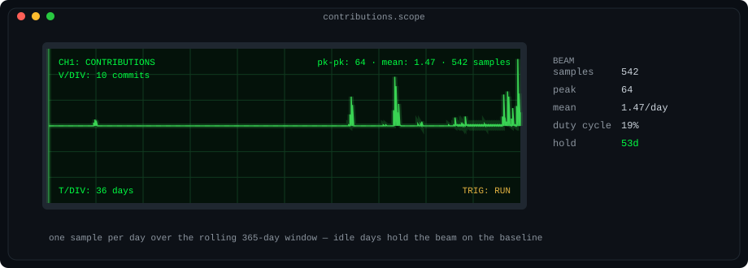

_One sample per day; idle days hold the beam on the baseline. The sweep line scans every seven seconds._

The contribution year as a training run: loss is the share of the year's work still owed, and it converges only when I ship. The scope on the right samples one day at a time — idle days hold the beam on the baseline.

### Recon

  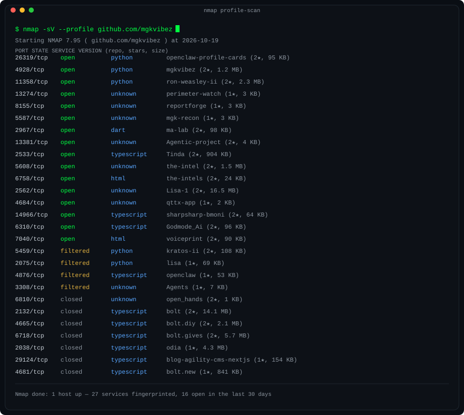

_Every repo is a service on host `github.com/mgkvibez` — open if pushed in the last 30 days, filtered within 90, closed beyond that. Ports are stable hashes of the repo name._

  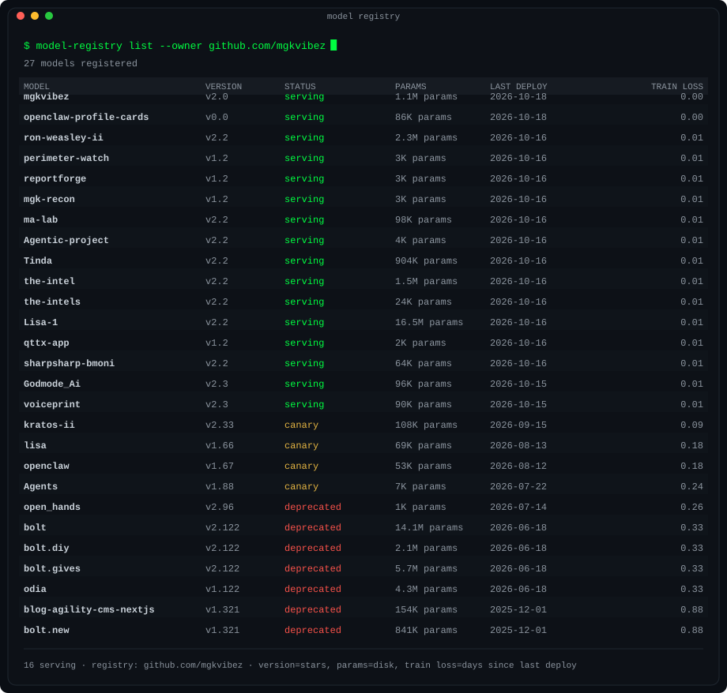

_Repos as models in a registry: version = stars, params = disk footprint, train loss = days since the last deploy. Loss drifts up while a repo sits idle._

Every repo is a service on host `github.com/mgkvibez` — open if pushed in the last 30 days, filtered within 90, closed beyond that. The registry frames them as models: version = stars, params = disk footprint, train loss = days since the last deploy.

---

## GitHub analytics

  
  

  

> Stats are rendered live by [github-readme-stats](https://github.com/anuraghazra/github-readme-stats) — no local generation or workflow needed, so they're always current.

  

---

## Contribution activity

<picture>
  <source media="(prefers-color-scheme: dark)" srcset="assets/images/github-contribution-grid-snake-dark.svg" />
  <source media="(prefers-color-scheme: light)" srcset="assets/images/github-contribution-grid-snake.svg" />
  
</picture>

<i>Auto-generated daily by <a href=".github/workflows/snake.yml">.github/workflows/snake.yml</a>. The snake starts electric blue and turns terminal green as it eats through the year — keyframe colours interpolated over its run, repainted after every regeneration.</i>

### Contribution city

  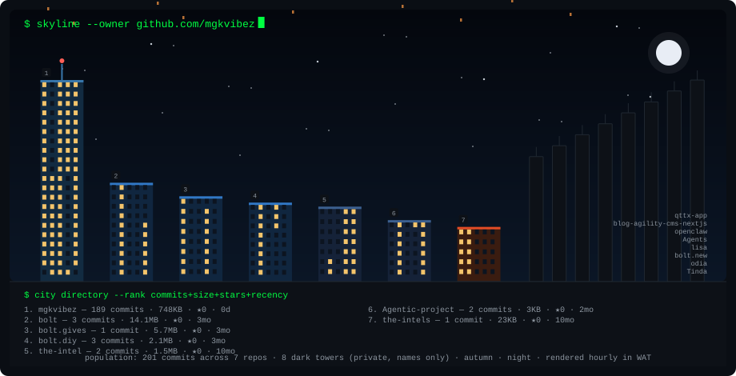

<i>Every repo is a skyscraper: height ranks commits (with codebase size and stars as tie-breakers), window lights track how recently it was pushed, the facade is tinted by its primary language, and the tallest tower wears the blinking beacon. Private repos rise as dark towers on the far edge — anonymous silhouettes, names only, no stats. The sky keeps real West African Time — sun by day, moon and stars by night, windows dimming at dawn — and the seasons pass through it: snow in winter, petals in spring, falling leaves in autumn. Re-rendered hourly, so a new repo gets its skyscraper within the hour.</i>

### Contribution heatmap

  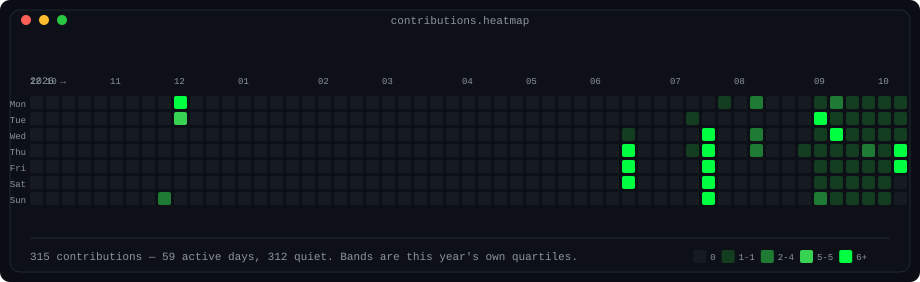

<i>A year of contributions, one cell per day. The four shades are quartiles of my own active days rather than fractions of the busiest one, and the legend prints the numeric range of every band — so the reading survives greyscale.</i>

### Languages and activity

  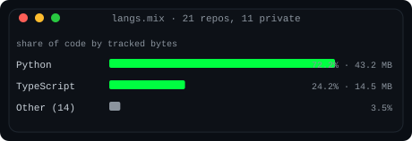
  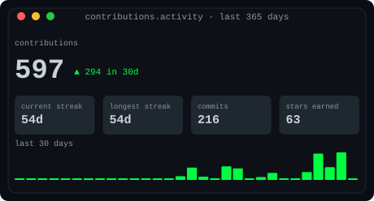

<i>Left: share of code by tracked bytes, ranked, with the private count in the scope line rather than hidden. Right: the headline numbers and a 30-day sparkline — deltas come from the snapshot archive (<code>history.jsonl</code>), and stay absent until the archive is old enough to answer.</i>

### Collaboration and rhythm

  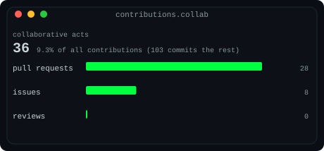
  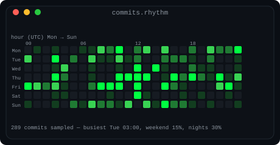

<i>Left: the part of a year's work that involved somebody else — commits are the denominator, not a bar, because a shared axis would turn the collaborative measures into pixel slivers. Right: when in the week and the day the commits actually land, sampled from recent history; every stamp is UTC and the card says so.</i>

### Years and drift

  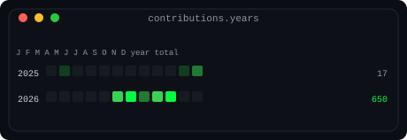
  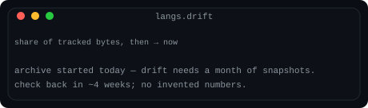

<i>Left: the long view — twelve monthly cells per year, shaded by the profile's own distribution. Right: the only derivative on the page — which way the language mix is moving. It needs a month of snapshots to have an honest "then", so until the archive is old enough it says exactly that instead of inventing one.</i>

---

## Projects

| Project | Status | Description |
|---|---|---|
| **Project Omega** | 🔥 In progress (~60%) | Fast vision models (PyTorch) + FastAPI serving + observability |
| **Kali Auto-Suite** | ⚙️ Planning | Automation for common pen-testing workflows (Bash, Python) |
| **infra-hardening-checks** | 🧪 Early stage | Automated container/config hardening checks for CI pipelines |

---

## Contributing

- Open an issue describing the bug or feature before sending a PR.
- Fork, branch off `main`, and include tests with any behavioral change.
- PRs are reviewed for reliability, test coverage, and clarity of design — not just "does it run."

---

## Contact

- X: [@mgkvibez](https://x.com/mgkvibez)
- Email: michaeloogwu58@gmail.com
- Found a real issue in one of my repos? Open an issue there directly — it's faster than DMs.

Open the table view

<!-- cards:table:start -->

| Right now | Reading | Move |
|---|---|---|
| Contributions (365d) | 396 total | ▲ 107 in 30d |
| Last 30 days | 142 | see the activity card |

| Metric | Last 365 days | Move |
|---|---:|---|
| Contributions | 396 | — |
| Commits | 108 | — |
| Pull requests | 31 | — |
| Issues | 8 | — |
| Reviews | 0 | — |
| Current streak | 0d | — |
| Longest streak | 46d | — |
| Repositories | 30 | — |
| Stars earned | 47 | — |
| Followers | 22 | — |
| Collaborative acts | 39 (9.8% of all) | — |

| Language | Share | Tracked size |
|---|---:|---:|
| TypeScript | 72.0% | 14.3 MB |
| Python | 20.8% | 4.1 MB |
| JavaScript | 4.7% | 960.7 kB |
| Other (9) | 2.4% | — |

| Commit rhythm | Value |
|---|---:|
| Busiest slot | Tue 03:00 (15 commits) |
| Sample | 289 recent commits |
| Nights, 22:00–06:00 | 30% of the sample |
| Clock | UTC — every stamp came back without an offset |

| Year | Contributions |
|---|---:|
| 2025 | 17 |
| 2026 | 382 |

| Building | Commits | Size | Stars | Last push | State | Access |
|---|---:|---:|---:|---|---|---|
| ron-weasley-ii | 289 | 2.3 MB | 2 | 2026-10-16 | occupied | private |
| [mgkvibez](https://github.com/mgkvibez/mgkvibez) | 252 | 1.4 MB | 2 | 2026-10-22 | occupied | public |
| Tinda | 91 | 904 kB | 2 | 2026-10-16 | occupied | private |
| [Lisa-1](https://github.com/mgkvibez/Lisa-1) | 18 | 16.5 MB | 2 | 2026-10-16 | occupied | public |
| [Godmode_Ai](https://github.com/mgkvibez/Godmode_Ai) | 17 | 96 kB | 2 | 2026-10-15 | occupied | public |
| [openclaw-profile-cards](https://github.com/mgkvibez/openclaw-profile-cards) | 9 | 146 kB | 2 | 2026-10-22 | occupied | public |
| perimeter-watch | 8 | 25 kB | 1 | 2026-10-20 | occupied | private |
| kratos-ii | 8 | 108 kB | 2 | 2026-09-15 | quiet | private |
| odia | 8 | 4.3 MB | 1 | 2026-06-18 | dormant | private |
| mgk-recon | 6 | 16 kB | 1 | 2026-10-20 | occupied | private |
| reportforge | 6 | 15 kB | 1 | 2026-10-20 | occupied | private |
| ma-lab | 6 | 98 kB | 2 | 2026-10-16 | occupied | private |
| [sharpsharp-bmoni](https://github.com/mgkvibez/sharpsharp-bmoni) | 6 | 64 kB | 2 | 2026-10-16 | occupied | public |
| voiceprint | 6 | 90 kB | 2 | 2026-10-15 | occupied | private |
| [paymock](https://github.com/mgkvibez/paymock) | 5 | 33 kB | 1 | 2026-10-20 | occupied | public |
| [voxserve](https://github.com/mgkvibez/voxserve) | 4 | 19 kB | 1 | 2026-10-20 | occupied | public |
| [Agentic-project](https://github.com/mgkvibez/Agentic-project) | 4 | 4 kB | 2 | 2026-10-16 | occupied | public |
| [pocketcrdt](https://github.com/mgkvibez/pocketcrdt) | 3 | 6 kB | 1 | 2026-10-20 | occupied | public |
| [the-intel](https://github.com/mgkvibez/the-intel) | 3 | 1.5 MB | 2 | 2026-10-16 | occupied | public |
| lisa | 3 | 69 kB | 1 | 2026-08-13 | quiet | private |
| Agents | 3 | 7 kB | 1 | 2026-07-22 | dormant | private |
| [bolt](https://github.com/mgkvibez/bolt) | 3 | 14.1 MB | 2 | 2026-06-18 | dormant | public |
| [bolt.diy](https://github.com/mgkvibez/bolt.diy) | 3 | 2.1 MB | 2 | 2026-06-18 | dormant | public |
| [the-intels](https://github.com/mgkvibez/the-intels) | 2 | 24 kB | 2 | 2026-10-16 | occupied | public |
| qttx-app | 2 | 2 kB | 1 | 2026-10-16 | occupied | private |
| [open_hands](https://github.com/mgkvibez/open_hands) | 2 | 1 kB | 2 | 2026-07-14 | dormant | public |
| openclaw | 1 | 53 kB | 1 | 2026-08-12 | quiet | private |
| [bolt.gives](https://github.com/mgkvibez/bolt.gives) | 1 | 5.7 MB | 2 | 2026-06-18 | dormant | public |
| blog-agility-cms-nextjs | 1 | 154 kB | 1 | 2025-12-01 | dormant | private |
| bolt.new | 1 | 841 kB | 1 | 2025-12-01 | dormant | private |

_Private repositories are listed for their activity only — they are not linked, because the link would 404 for everyone but me._

_Generated by `cards/` on 2026-10-22, from the live GitHub GraphQL API. Table maintained between the cards:table markers._
<!-- cards:table:end -->

